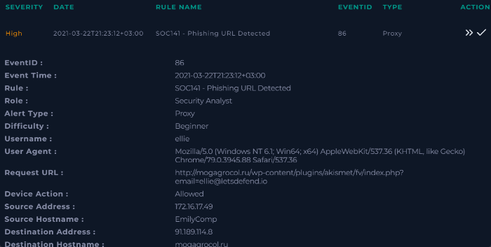
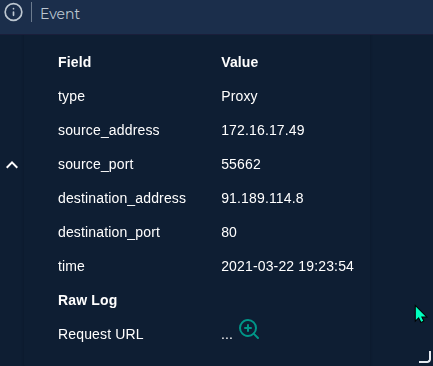
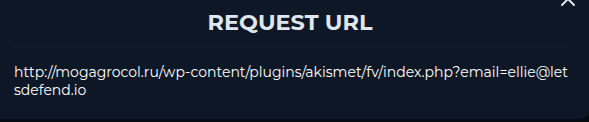
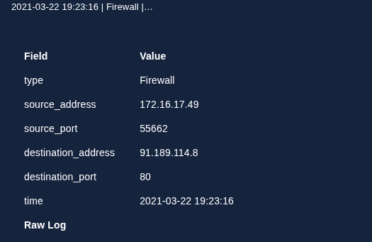

# SOC141 — Phishing URL Detected

> **Environnement :** Let's Defend — SOC Analyst Lab  
> **Alert ID :** 86  
> **Verdict :** True Positive  
> **Sévérité initiale :** High

---

## 1. Résumé exécutif

### Contexte

Cette investigation porte sur une alerte `Phishing URL Detected` détectée dans l'environnement de formation SOC Analyst de Let's Defend.

L'alerte concerne une activité HTTP depuis le poste `EmilyComp` (`172.16.17.49`), associé à l'utilisateur `ellie`, vers l'adresse IP de destination `91.189.114.8` sur le port `80`.

Le log Proxy contient une URL suspecte hébergée sur le domaine `mogagrocol[.]ru`.

### Principaux résultats

- L'URL suspecte a été retrouvée dans le log Proxy.
- Le champ `Device Action` de l'alerte indique `Allowed`.
- Les résultats de Threat Intelligence consultés soutiennent la qualification malveillante de l'URL.
- Le poste concerné a été isolé via la fonctionnalité Endpoint Security de l'environnement Let's Defend.

### Verdict

**True Positive — activité associée à une URL malveillante observée.**

Les éléments disponibles justifient la qualification de l'alerte en True Positive. En revanche, ils ne permettent pas de confirmer que la page a été chargée avec succès, que des identifiants ont été transmis, qu'un malware a été exécuté ou que le poste a été compromis.

---

## 2. Présentation de l'alerte

### Alerte initiale

L'alerte suivante a déclenché l'investigation et constitue le point de départ de l'analyse.

Cette alerte identifie une activité HTTP associée à une URL suspecte depuis le poste `EmilyComp`.

| Champ | Valeur |
|---|---|
| Nom de l'alerte | Phishing URL Detected |
| Alert ID | `86` |
| Type | Proxy |
| Sévérité | High |
| Source IP | `172.16.17.49` |
| Source hostname | `EmilyComp` |
| Utilisateur associé | `ellie` |
| Destination IP | `91.189.114.8` |
| Destination port | `80` |
| Protocole | HTTP |
| Environnement | Let's Defend — SOC Analyst Lab |

### 2.1. URL observée dans l'alerte

L'alerte était associée à l'URL suivante :
`hxxp://mogagrocol[.]ru/wp-content/plugins/akismet/fv/index.php?email=ellie@letsdefend[.]io`

Le champ `Device Action` indiquait `Allowed`.

Cette valeur indique que le dispositif a enregistré une action d'autorisation. Elle ne prouve pas, à elle seule, que la page a été chargée avec succès ou qu'un contenu malveillant a été exécuté.

---

## 3. Périmètre et objectifs de l'investigation

L'investigation avait pour objectifs de :

- Valider et qualifier l'alerte.
- Examiner les logs Proxy et Firewall disponibles.
- Évaluer la réputation de l'URL et de l'adresse IP de destination.
- Identifier les Indicators of Compromise (IOC) pertinents.
- Corréler les événements réseau disponibles.
- Évaluer l'impact potentiel sur le poste et le compte utilisateur.
- Documenter le containment effectué et les mesures de remédiation recommandées.

L'analyse est limitée aux éléments disponibles dans l'environnement de formation.

---

## 4. Analyse des logs et corrélation

### Validation de l'événement Proxy

L'événement Proxy associé à l'alerte présente les mêmes adresses IP source et destination que celles observées dans l'alerte.

Cet événement confirme qu'une communication HTTP a été enregistrée entre le poste `EmilyComp` (`172.16.17.49`) et l'adresse IP `91.189.114.8`.

### Validation de l'URL observée

La consultation du détail de l'événement permet d'afficher l'URL complète associée à la requête HTTP.

L'URL observée dans le log Proxy correspond à celle mentionnée dans l'alerte :

`hxxp://mogagrocol[.]ru/wp-content/plugins/akismet/fv/index.php?email=ellie@letsdefend[.]io`

Cette correspondance renforce la corrélation entre l'alerte et l'événement Proxy analysé.

### Corrélation avec l'événement Firewall

L'événement Firewall associé à l'activité observée présente les mêmes adresses IP source et destination que celles relevées dans l'alerte et le log Proxy.

Cet événement montre qu'une communication réseau a été enregistrée entre le poste `EmilyComp` (`172.16.17.49`) et l'adresse IP `91.189.114.8`.

La cohérence des adresses IP, des ports et des horodatages renforce la corrélation entre l'alerte, l'événement Proxy et l'événement Firewall.

### 4.1. Événements réseau identifiés
Deux événements ont été retrouvés dans Log Management.

| Événement | Timestamp affiché | Source | Destination |
|---|---|---|---|
| Firewall | `2021-03-22 19:23:16` | `172.16.17.49:55662` | `91.189.114.8:80` |
| Proxy | `2021-03-22 19:23:54` | `172.16.17.49:55662` | `91.189.114.8:80` |

Le log Proxy contenait l'URL suspecte. Les deux événements présentaient les mêmes adresses IP source et destination ainsi que les mêmes ports.

Ces éléments sont cohérents avec l'activité réseau associée à l'alerte.

### 4.2. Interprétation des événements

Les éléments observés permettent d'établir que :

- Une activité réseau entre `172.16.17.49` et `91.189.114.8` a été enregistrée.
- Le log Proxy associait cette activité à l'URL suspecte.
- Le champ `Device Action` de l'alerte indiquait `Allowed`.
- Le log Firewall examiné ne permettait pas, à lui seul, de confirmer si la connexion avait été autorisée ou bloquée.

Les données disponibles ne confirment pas que la page a été chargée avec succès, qu'un fichier a été téléchargé ou qu'un code malveillant a été exécuté.

### 4.3. Vérification des timestamps

Le timestamp de l'alerte était :

`2021-03-22T21:23:12+03:00`

Il correspond à `2021-03-22 18:23:12 UTC`.

Les logs Firewall et Proxy affichaient respectivement `19:23:16` et `19:23:54`.

Le fuseau horaire des sources de logs n'ayant pas été établi, une comparaison directe ne permet pas de conclure à une incohérence temporelle. La timeline devra être consolidée après vérification des paramètres de temps des sources concernées.

### 4.4. Évaluation des preuves réseau

Les logs permettent de corréler l'URL suspecte avec une activité réseau provenant du poste `EmilyComp`.

Ils ne permettent pas, à eux seuls, de confirmer :

- Le chargement réussi de la page.
- La soumission d'identifiants.
- Le téléchargement d'un fichier.
- L'exécution d'un payload.
- La compromission effective du poste.

---

## 5. Analyse Threat Intelligence

### 5.1. Sources consultées

Les outils suivants ont été utilisés pour évaluer la réputation de l'URL et de l'adresse IP :

- **VirusTotal** : réputation de l'URL et de l'adresse IP.
- **URLhaus** : recherche de l'URL dans la base de données de malware URLs.
- **URLScan.io** : recherche d'informations contextuelles sur le site web.
- **Hybrid Analysis** : consultation des résultats de détection disponibles.

Les résultats ont été comparés afin de ne pas fonder la décision sur un seul indicateur.

### 5.2. Résultats observés

| Source | Résultat observé | Interprétation |
|---|---|---|
| VirusTotal — IP `91.189.114.8` | 1 détection malveillante sur 92 moteurs | Indice faible pris isolément ; insuffisant pour qualifier l'IP de malveillante avec certitude. |
| VirusTotal — URL | 10 détections malveillantes, dont 3 classifications phishing, selon les résultats relevés | Indice en faveur d'une URL malveillante. |
| URLhaus | Aucun résultat pour la recherche effectuée | Absence de corroboration par cette source ; ne prouve pas que l'URL est légitime. |
| URLScan.io | Informations contextuelles sur le site et les technologies WordPress/PHP relevées dans les notes d'investigation | Ces informations ne constituent pas, à elles seules, une preuve de malveillance. |
| Hybrid Analysis | Résultat affiché : `MALICIOUS (100)` | Indice fort en faveur d'une URL malveillante. |

### 5.3. Interprétation

Les résultats de VirusTotal concernant l'URL et le résultat de Hybrid Analysis soutiennent la qualification malveillante de l'URL.

La réputation de l'URL complète doit être distinguée de celle de l'adresse IP. Une faible détection de l'IP ne permet pas d'écarter la malveillance de l'URL.

De même, l'absence de résultat dans URLhaus ne constitue pas une preuve d'innocuité.

### 5.4. Conclusion Threat Intelligence

Les résultats disponibles soutiennent la qualification malveillante de l'URL. Associés à la présence de cette URL dans le log Proxy, ils justifient le verdict **True Positive** pour l'alerte.

Ils ne prouvent toutefois ni un vol d'identifiants, ni l'exécution d'un malware, ni une compromission effective du poste.

---

## 6. Recherches complémentaires

### 6.1. Recherche par adresse IP

Le filtre suivant a été utilisé dans Log Management :

`Destination Address contains 91.189.114.8`

Deux événements ont été retournés :

- Un événement Proxy daté du `2021-03-22 19:23:54`, contenant l'URL suspecte.
- Un événement Firewall daté du `2021-03-22 19:23:16`, associé à la même adresse IP de destination.

Les deux événements présentaient la même IP source (`172.16.17.49`), la même IP de destination (`91.189.114.8`), le port source `55662` et le port de destination `80`.

### 6.2. Recherche par domaine

Le filtre suivant a été utilisé :

`Raw Log contains mogagrocol.ru`

Un événement Proxy a été retourné. Son contenu associait le domaine à l'URL suspecte déjà identifiée.

Cette recherche confirme la présence du domaine dans l'événement consulté. Elle ne permet pas de conclure que ce domaine n'a été utilisé par aucun autre poste ou à aucune autre période.

### 6.3. Résultat de la corrélation

Les recherches complémentaires renforcent la corrélation entre l'URL, le domaine, l'adresse IP de destination et l'activité réseau observée sur `EmilyComp`.

Aucun élément disponible dans ces recherches ne confirme le succès du chargement de la page, le téléchargement d'un fichier malveillant ou l'exécution d'un payload.

---

## 7. Indicators of Compromise (IOC)

Les indicateurs ci-dessous ont été identifiés au cours de l'investigation. Leur qualification repose sur les logs examinés et les résultats de Threat Intelligence disponibles.

| Type | Valeur | Qualification | Justification |
|---|---|---|---|
| URL | `hxxp://mogagrocol[.]ru/wp-content/plugins/akismet/fv/index.php?email=ellie@letsdefend[.]io` | URL malveillante | Présente dans le log Proxy et signalée par plusieurs sources de Threat Intelligence. |
| Domaine | `mogagrocol[.]ru` | Domaine suspect associé à l'URL malveillante | Présent dans l'URL associée à l'activité réseau observée. |
| IP de destination | `91.189.114.8` | Infrastructure associée à l'activité suspecte | Destination de la requête observée ; réputation de l'IP insuffisante pour la qualifier seule de malveillante. |

### 7.1. Éléments de contexte

Les éléments suivants permettent de contextualiser l'activité mais ne sont pas, en eux-mêmes, des IOC malveillants :

- **Source IP :** `172.16.17.49`
- **Hostname :** `EmilyComp`
- **Utilisateur associé :** `ellie`

Ces informations identifient le poste et le compte associés à l'activité observée. Elles ne prouvent pas une compromission.

---

## 8. Qualification de l'incident et impact

### 8.1. Verdict final

| Élément | Conclusion |
|---|---|
| Alerte | Phishing URL Detected |
| Sévérité initiale | High |
| Verdict | **True Positive** |
| URL | URL malveillante selon les résultats de Threat Intelligence consultés |
| Domaine | `mogagrocol[.]ru` |
| IP de destination | `91.189.114.8` |
| Poste concerné | `EmilyComp` |
| Containment | Poste isolé dans Let's Defend |

### 8.2. Éléments établis

- L'URL suspecte était présente dans le log Proxy.
- Une activité réseau associée au poste concerné a été enregistrée.
- Les résultats de Threat Intelligence soutiennent la qualification malveillante de l'URL.
- Le poste a été isolé dans l'environnement de formation.

### 8.3. Éléments non confirmés

Les données disponibles ne permettent pas de confirmer :

- Le chargement réussi de la page.
- La soumission d'identifiants.
- Le téléchargement ou l'exécution d'un fichier malveillant.
- La compromission du poste ou du compte utilisateur.
- L'existence d'autres accès au domaine depuis d'autres postes.

Le verdict True Positive concerne l'alerte associée à l'URL malveillante et ne signifie pas que tous les scénarios d'impact ont été confirmés.

---

## 9. Incident Response et remédiation

### 9.1. Containment effectué

Le poste `EmilyComp` (`172.16.17.49`) a été isolé via la fonctionnalité Endpoint Security de l'environnement Let's Defend.

Cette action visait à limiter les communications potentielles pendant l'investigation.

### 9.2. Mesures de remédiation recommandées

Les actions suivantes sont recommandées et ne sont pas toutes confirmées comme ayant été exécutées :

1. Bloquer l'URL et le domaine au niveau des contrôles de sécurité appropriés.
2. Rechercher d'autres connexions au domaine dans les logs Proxy et Firewall.
3. Examiner les logs EDR et Endpoint Security pour identifier d'éventuels téléchargements, processus suspects ou mécanismes de persistance.
4. Vérifier les fichiers téléchargés et les processus exécutés à la suite de l'activité suspecte.
5. Si la soumission d'identifiants est suspectée ou confirmée, réinitialiser les identifiants concernés et révoquer les sessions actives.
6. Ne rétablir la connexion du poste qu'après évaluation de son état de sécurité.

### 9.3. Vérifications restantes

Avant de clôturer l'investigation, il conviendrait de :

- Vérifier les fuseaux horaires des sources de logs.
- Déterminer si la page a retourné un contenu.
- Examiner la télémétrie Endpoint pour rechercher des signes de compromission.
- Rechercher d'autres connexions au domaine suspect.
- Confirmer les mesures de blocage et de remédiation effectivement appliquées.

---

## 10. Conclusion et enseignements

### 10.1. Conclusion

L'investigation a permis d'identifier une URL malveillante dans les logs Proxy et de corréler cette activité avec les événements réseau disponibles. Les résultats de Threat Intelligence soutiennent la qualification de l'alerte en **True Positive**.

Le poste concerné a été isolé à titre de mesure de containment dans l'environnement de formation.

En revanche, les éléments disponibles ne confirment ni le chargement réussi de la page, ni le vol d'identifiants, ni l'exécution d'un malware, ni la compromission du poste.

### 10.2. Limites

Les principales limites de l'investigation sont :

- Les fuseaux horaires des logs ne sont pas établis.
- Le succès du chargement de la page n'est pas confirmé.
- Aucun élément disponible ne confirme la soumission d'identifiants ou l'exécution d'un malware.
- La recherche d'autres accès au domaine sur l'ensemble de l'environnement reste à approfondir.
- Toutes les recommandations de remédiation ne sont pas confirmées comme ayant été appliquées.

### 10.3. Enseignements

Ce scénario met en pratique plusieurs compétences SOC :

- Triage et qualification d'une alerte.
- Analyse et corrélation de logs Proxy et Firewall.
- Enrichissement d'indicateurs via la Threat Intelligence.
- Identification et documentation des IOC.
- Distinction entre faits observés, hypothèses et impact confirmé.
- Documentation du containment et des recommandations de remédiation.

Le rapport est fondé sur un scénario de formation Let's Defend et reflète uniquement les éléments disponibles au cours de l'investigation.
